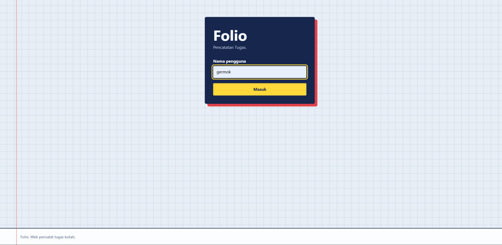
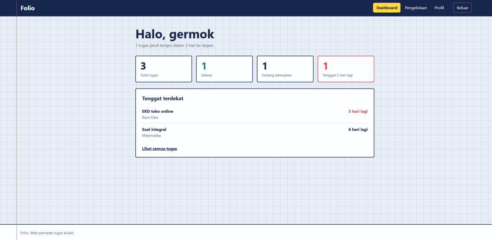
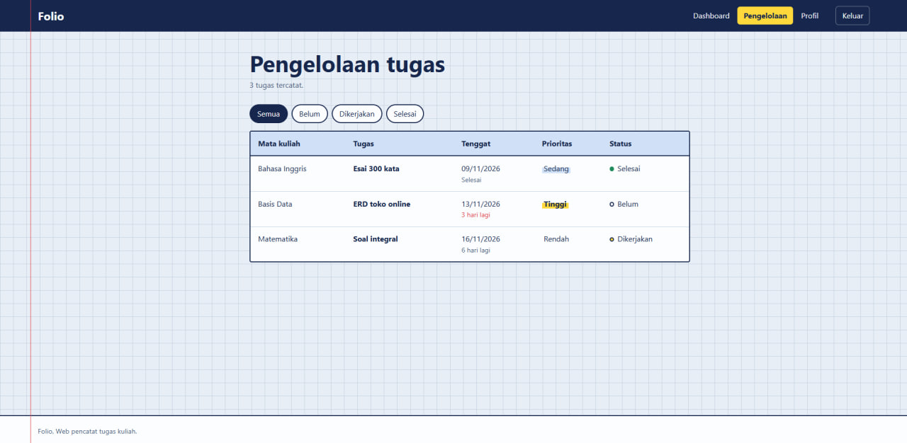
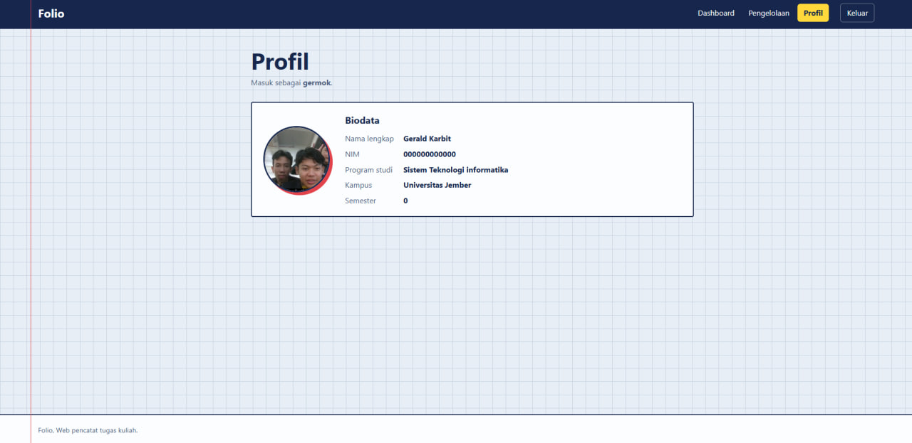

# UTS Pemrograman Web (PWEB)

Aplikasi web berbasis **Laravel** yang dibuat untuk memenuhi tugas **Ujian Tengah Semester (UTS) Pemrograman Web**.

## Deskripsi

[Tuliskan deskripsi singkat aplikasi, misalnya: aplikasi ini digunakan untuk mengelola data ... dengan fitur login, dashboard, manajemen data pengelola, dan profil pengguna.]

## Fitur

-  **Login** – autentikasi pengguna sebelum masuk ke sistem
-  **Dashboard** – ringkasan informasi dalam bentuk kartu
-  **Data Pengelola** – menampilkan dan mengelola data dalam bentuk tabel
-  **Profil** – menampilkan informasi akun pengguna
-  **Logout** – keluar dari sistem

## Tampilan Aplikasi

### Halaman Login



### Halaman Dashboard



### Halaman Pengelola



### Halaman Profil



## Teknologi yang Digunakan

- **Framework:** Laravel (PHP 8.2+)
- **Frontend:** Blade Template, CSS, JavaScript


## Cara Menjalankan

### Prasyarat
- PHP 8.2 atau lebih baru
- Composer
- Node.js & npm
- MySQL (sudah termasuk di Laragon)

### Langkah Instalasi

1. **Clone repository** ke folder `www` Laragon:
   ```bash
   cd C:\laragon\www
   git clone https://github.com/Loidk/UTS_PWEB_252410103057.git UTS_PWEB
   cd UTS_PWEB
   ```


2. **Jalankan aplikasi:**
   ```bash
   npm run dev
   php artisan serve
   ```
   Buka di browser: [http://127.0.0.1:8000](http://127.0.0.1:8000)


